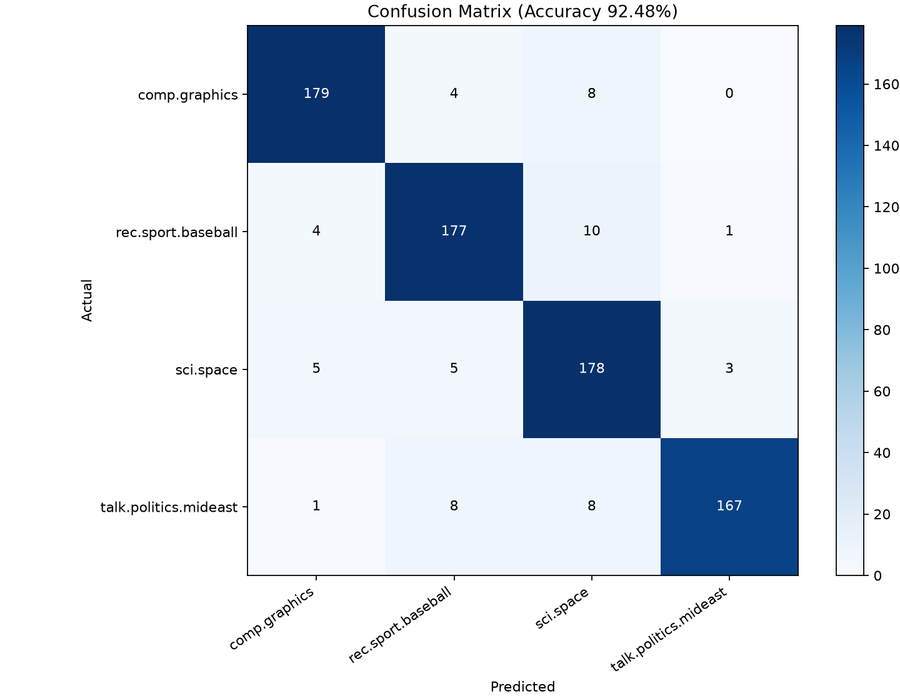

# A4_1 문서 검색 및 분류 시스템

NumPy로 TF-IDF와 코사인 검색을 구현하고, 20 Newsgroups 네 카테고리의 문서를 Logistic Regression으로 분류합니다. 사용자 제공 Python 소스를 로컬에 복원한 후 2026-11-12에 검증했습니다.

## 1. 구현 요약

### 데이터와 전처리

`comp.graphics`, `rec.sport.baseball`, `sci.space`, `talk.politics.mideast`의 원본 3,894건을 사용했습니다. `headers`, `footers`, `quotes`를 제거하고 이메일과 일반적인 전화번호 형식을 마스킹했습니다. 공백만 남은 107건을 제외해 3,787건을 확보했습니다. `train_test_split(test_size=0.2, random_state=42, stratify=labels)`로 Train 3,029건, Test 758건을 고정했습니다. 이번 분할에서 Train/Test 사이 완전히 동일한 본문은 0건입니다.

| 카테고리 | Train | Test |
| --- | --- | --- |
| comp.graphics | 764 | 191 |
| rec.sport.baseball | 766 | 192 |
| sci.space | 764 | 191 |
| talk.politics.mideast | 735 | 184 |

소문자화 후 `r'(?u)\b\w\w+\b'`로 두 글자 이상의 Unicode 단어 토큰을 추출합니다. 숫자와 밑줄도 단어 문자에 포함됩니다. 한 글자 `C`와 `C++` 같은 용어의 손실은 현재 규칙의 한계입니다. 동의어 치환은 적용하지 않습니다.

고정 불용어 123개는 [stopwords_en.txt](resources/stopwords_en.txt)에 있습니다. 사용자 제공 소스의 목록을 프로젝트 기준 `a4-1-en-v1`로 채택하고 기능어 제거의 선정 근거와 UTF-8·LF 정규화 해시를 기록했습니다. 외부 목록의 원출처·버전은 제공되지 않았습니다. `no`, `nor`, `not`도 포함돼 부정 표현이 손실될 수 있습니다. 파일 경로는 모듈 위치를 기준으로 합니다. [목록 선정 근거와 해시](docs/A4_1_data_sources.md)

어휘 33,297개와 IDF는 Train에서만 학습합니다. Test와 질의에는 학습된 어휘·IDF를 그대로 사용하고 OOV는 제외합니다. 데이터 분포와 코퍼스 SHA-256은 [데이터 메타데이터](artifacts/dataset_metadata.json)에 기록했습니다.

### TF-IDF와 코사인 검색

문서 수를 $N$, 단어 출현 횟수를 $c_{d,t}$라 두면 다음과 같습니다.

$$tf(d,t)=c_{d,t},\quad df(t)=\sum_d\mathbf{1}[c_{d,t}>0]$$
$$idf(t)=\ln\left(\frac{1+N}{1+df(t)}\right)+1,\quad x_{d,t}=tf(d,t)idf(t)$$
$$\hat{x}_d=x_d/\|x_d\|_2\quad(\|x_d\|_2>0)$$

영벡터는 0으로 유지합니다. 어휘 열을 알파벳 순으로 정렬하고 `float64`로 계산합니다. 핵심 계산은 [tfidf.py](src/tfidf.py)에 있습니다. sklearn은 데이터 로딩·검증·분류에 사용하며, 직접 구현한 TF-IDF와 코사인 점수 계산은 NumPy를 사용합니다.

$$\cos(d,q)=\frac{d\cdot q}{\|d\|_2\|q\|_2}=\hat{d}\cdot\hat{q}$$

[search_engine.py](src/search_engine.py)는 정규화된 문서 행렬과 질의 벡터를 곱합니다. 점수가 양수인 문서만 반환하고 점수 내림차순, 동점 시 문서 ID 오름차순을 적용합니다. `np.partition`으로 Top-K 경계를 선택한 뒤 경계 동점을 포함해 정렬합니다. Dense 점수 계산은 $O(N|V|)$이고, 경계 동점이 많으면 후보 정렬 비용이 커집니다. 빈 입력과 OOV 질의는 빈 리스트를 반환합니다.

### 모듈과 실행 환경

| 모듈 | 역할 |
| --- | --- |
| src/dataset.py | 다운로드·캐시·마스킹·고정 분할 |
| src/preprocess.py | 불용어 로딩·소문자화·토큰화 |
| src/tfidf.py | Train 어휘·DF·IDF와 NumPy 변환 |
| src/search_engine.py | 코사인 점수·Top-K·인덱스 저장·로드 |
| src/classifier.py | Logistic Regression·지표·혼동 행렬·오분류 근거 |
| verify_tfidf.py | 어휘·TF·DF·IDF·Train/Test/질의 대조 |
| main.py | CLI와 `search()` 진입점 |

전처리와 벡터화를 분리해 검색·분류에서 같은 표현을 재사용합니다. 검색 전략과 분류 모델을 교체할 때 전처리 규칙을 유지하고 단계별 오류를 확인할 수 있습니다. 분류에는 `LogisticRegression(max_iter=1000, random_state=42)`를 사용합니다. NumPy 결과를 CSR로 변환해 분류기에 전달하고 BLAS 스레드는 2개로 제한했습니다. 이번 학습은 27회 반복으로 종료됐습니다.

검증 환경은 Windows, Python 3.14.7, uv 0.13.7, NumPy 2.5.4, scikit-learn 1.9.1입니다. 의존성은 [requirements.txt](requirements.txt)에 고정했습니다. 첨부 소스의 NumPy `<2`, sklearn `<1.4` 범위는 현재 Python과 맞지 않아 설치된 조합을 사용했습니다. 미션은 Python 3.10 이상을 요구하며 현재 패키지 조합은 Python 3.14.7에서 검증했습니다.

CMD에서 환경을 준비합니다. 기존 `.venv`가 있으면 활성화부터 진행합니다.

```bat
cd /d D:\git\A4_1
uv venv
.venv\Scripts\activate
uv pip install -r requirements.txt
```

PowerShell의 활성화 명령은 다음과 같습니다.

```powershell
.\.venv\Scripts\Activate.ps1
```

CLI 안 A는 다음과 같습니다. 최초 데이터 다운로드에는 네트워크가 필요하며 이후에는 `artifacts/data_cache`를 사용합니다.

```bash
python verify_tfidf.py
python main.py --query "space satellite launch orbit" --topk 5
python main.py --train-classifier
python main.py --bonus
python -m unittest discover -s tests -v
```

인덱스를 저장하면 다음 검색부터 학습 없이 로드합니다. 데이터를 변경하면 인덱스를 다시 생성해야 합니다.

```bash
python main.py --build-index
python main.py --query "computer graphics rendering image" --topk 5
```

함수 안 B도 지원합니다.

```python
from main import search

# search(query: str, top_k: int = 5) -> List[Tuple[float, int, str]]
for score, doc_id, text_snippet in search("space satellite launch orbit", top_k=5):
    print(f"{score:.4f} {doc_id} {text_snippet}")
```

## 2. 검증 및 실험 결과

### TF-IDF 수치 검증

sklearn 참조 설정은 공통 `TextPreprocessor.tokenize` analyzer, `smooth_idf=True`, `sublinear_tf=False`, `norm='l2'`, `dtype=np.float64`입니다. callable analyzer가 소문자화·토큰화·불용어 제거를 모두 수행합니다. 어휘와 열 순서, TF 및 DF를 동일성 비교하고 IDF와 최종 벡터를 대조했습니다.

| 입력 | Shape | 최대 절대 오차 | 평균 절대 오차 |
| --- | --- | --- | --- |
| Train | 3,029 × 33,297 | 2.3315e-15 | 3.0568e-20 |
| Test | 758 × 33,297 | 8.3267e-16 | 2.2134e-20 |
| 질의 5개 | 5 × 33,297 | 0 | 0 |

IDF 오차는 0입니다. 미션의 `1e-6` 허용 기준을 통과했습니다. 질의에는 빈 문자열, 불용어만 있는 문자열, OOV를 포함했습니다. 실패 시 검증 스크립트가 예외로 종료되도록 수정했습니다. [검증 결과 JSON](artifacts/tfidf_verification.json), [실행 출력](artifacts/run_logs/verify_tfidf.txt)

```text
train: shape=[3029, 33297] max_error=2.3315e-15 mean_error=3.0568e-20
test: shape=[758, 33297] max_error=8.3267e-16 mean_error=2.2134e-20
queries: shape=[5, 33297] max_error=0.0000e+00 mean_error=0.0000e+00
Vocabulary/TF/DF/IDF and Train/Test/query checks PASS; IDF error=0.0000e+00
```

### 검색 실행 결과

아래는 실제 출력에서 점수·문서 ID·스니펫의 일부를 발췌한 결과입니다. 문서 ID는 고정 Train 목록의 0 기반 인덱스입니다. [전체 검색 출력](artifacts/run_logs/search.txt)

```text
=== Search Results for 'space satellite launch orbit' (Top 5) ===
[1] Score: 0.4737 | Doc #1934: COMMERCIAL SPACE NEWS/SPACE TECHNOLOGY INVESTOR NUMBER 22
[2] Score: 0.3076 | Doc #2609: The Space Calendar is updated monthly
[3] Score: 0.2954 | Doc #755: [Regarding orbital billboards...]
[4] Score: 0.2932 | Doc #2145: Navstar GPS Constellation Status
[5] Score: 0.2701 | Doc #1725: Putting a satellite as high as possible
```

### 분류 지표와 혼동 행렬

Test 758건 중 701건을 맞혀 Accuracy **92.4802%**, Macro-F1 **0.925329**를 얻었습니다. 오분류는 57건입니다. [전체 분류 지표와 사례](artifacts/classifier_metrics.json), [실행 출력](artifacts/run_logs/classifier.txt)

| 클래스 | Precision | Recall | F1 | Test 건수 |
| --- | --- | --- | --- | --- |
| comp.graphics | 0.9471 | 0.9372 | 0.9421 | 191 |
| rec.sport.baseball | 0.9124 | 0.9219 | 0.9171 | 192 |
| sci.space | 0.8725 | 0.9319 | 0.9013 | 191 |
| talk.politics.mideast | 0.9766 | 0.9076 | 0.9408 | 184 |



```text
Classification Accuracy: 92.4802% | Macro-F1: 0.925329
[[179   4   8   0]
 [  4 177  10   1]
 [  5   5 178   3]
 [  1   8   8 167]]
```

요청된 네 CLI 명령은 모두 종료 코드 0으로 완료했습니다. [명령별 검증 기록](artifacts/verification_results.json)에 실행 시각과 로그 경로를 기록했습니다. `tests/`의 회귀 검사는 빈 입력·OOV·Train 전용 학습·동점 경계·인덱스 저장/로드·BM25 수식·역색인 재구축 등을 확인합니다.

선행 문서의 정확도 97.56%, Macro-F1 0.9758 및 오차 1.1102e-15는 과거 제공 자료의 기록입니다. 이번 소스와 고정 데이터 처리에서 나온 결과는 위 표에 반영했습니다. 원본 코드에서 빈 문서 제거, 실행 오류 수정, 실제 보너스 검증 및 오분류 근거 수집을 보완했습니다.

## 3. BoW 한계와 오분류 원인

### 실제 Test 오분류 5건

아래 ID는 Test 목록의 0 기반 인덱스입니다. 설명은 실제 본문과 선형 모델의 클래스 점수 차이를 근거로 한 원인 가설입니다. 기여도는 $x_t(w_{pred,t}-w_{true,t})$로 계산하며 양수이면 예측 클래스를 지지합니다. 전체 점수 차이는 기여도 합에 절편 차이를 더한 값입니다. 인명은 본문 발췌에서 생략했습니다.

| Test ID | 실제 → 예측 | 본문 근거 | 기여도 및 분석 |
| --- | --- | --- | --- |
| 3 | mideast → space | `palestinian police force`, `concrete proposals`, `idea` | `palestinian` -0.3580, `police` -0.1445가 실제 클래스를 지지했지만 `idea` +0.2409 등 일반 어휘와 절편 +0.2461이 합쳐져 space가 0.0123 앞섰습니다. 정치적 구문의 관계를 독립 단어 가중치만으로 충분히 표현하기 어렵다는 가설입니다. |
| 5 | graphics → space | `What is 9 x 6?`, `base 13 system` | `system` +0.1815, `base` +0.0935가 space를 지지했습니다. 한 글자 `9`, `x`, `6`은 정규식에서 사라집니다. 게시글 대화 맥락과 그래픽 주제 단서가 부족한 짧은 문서의 오류입니다. |
| 13 | graphics → baseball | `RS6000 compiler`, `COBOL`, `pascal` | `pascal` -0.0931, `compiler` -0.0895가 실제 클래스를 지지했지만 잔존 서명 토큰 +0.2122와 `think` +0.1741이 다른 클래스를 밀었습니다. 서명 제거의 불완전성과 이름·일반 단어의 우연한 상관관계가 드러납니다. |
| 19 | baseball → space | `SI`, `article`, `subscription`, `date` | `si` +0.1221, `date` +0.0700이 space를 지지했고 최종 점수 차이는 0.0233입니다. 약어의 의미와 기사 대상의 문맥을 unigram만으로 복원하기 어려운 사례입니다. |
| 25 | mideast → space | `What are you stupid?` | 불용어 제거 후 `stupid`만 남습니다. 이 단어의 기여도는 -0.1325지만 절편 차이 +0.2461이 커 최종 space 점수가 0.1136 앞섰습니다. 주제 정보가 거의 없는 짧은 문서에서 클래스 기본 경향에 의존합니다. |

### 표현 방식의 한계와 개선 실험

`dog bites man`과 `man bites dog`는 같은 빈도로 표현돼 주어·목적어의 차이를 잃습니다. `bank`와 `사과` 같은 다의어는 하나의 차원에 합쳐지고 `car`와 `automobile` 같은 동의어는 다른 차원에 나뉩니다. 위 실제 사례에서는 짧은 문서, 약어, 잔존 서명과 전처리 손실을 확인했습니다. 각 사례의 개선 여부는 추가 실험으로 검증해야 합니다.

후속 비교는 부정어 보존, 도메인 토큰 정규식, bigram, 문맥 임베딩 또는 Transformer 모델을 대상으로 합니다. 같은 분할에서 Accuracy·Macro-F1을 비교하고, 관련도 정답이 있는 평가 쿼리로 Precision@5와 nDCG@5를 측정해야 합니다. 현재 검색 결과의 주제 적합성과 순위 변화는 관찰했으며 검색 품질 정답셋은 구축 대기 상태입니다.

백만 문서·어휘 5만 개의 dense float64 행렬은 원소만 약 400GB가 필요합니다. 희소 저장·역색인·후보 가지치기·캐시를 비교하고 인덱스 구축 비용과 질의 지연 p50/p95를 나눠 측정하는 방향입니다.

### 데이터 이용과 검수 상태

sklearn 문서는 헤더 등 메타데이터가 분류 성능에 영향을 줄 수 있음을 설명합니다. 현재 구현은 헤더·푸터·인용 제거와 이메일·일반 전화번호 마스킹을 수행합니다. 실제 결과에 서명과 인명이 남아 있어 미션의 개인정보 미포함 조건에 대한 추가 검수가 필요합니다. 원본 데이터는 자동 다운로드 캐시에 보관합니다. [sklearn 데이터셋 설명](https://scikit-learn.org/stable/datasets/real_world.html#the-20-newsgroups-text-dataset)

실제 sklearn 다운로드 파일과 일치하는 Figshare file ID `5975967`, 항목 `3829962` 버전 2에서 CC BY 4.0 표기를 확인했습니다. 출처 표기는 Nelson Liu, 2016, `scikit-learn 20newsgroups dataset 20news-bydate.tar.gz`, version 2, Figshare입니다. 네 카테고리 선택·메타데이터 제거·마스킹·빈 문서 제외·재분할·수치 변환의 변경 내용을 출처 보고서에 기록했습니다. [배포 기록 DOI](https://doi.org/10.6084/m9.figshare.3829962.v2), [CC BY 4.0](https://creativecommons.org/licenses/by/4.0/), [출처와 이용 조건 보고서](docs/A4_1_data_sources.md)

후속 자동 검사에서 사용 데이터 3,787건의 이메일·지정 전화번호 패턴은 0건이었습니다. 대문자 단어 조합 후보는 18,426개가 2,292개 문서에서 검출됐으며 제목·기관명도 포함합니다. 이 검사는 소문자 인명이나 다른 식별 정보를 놓칠 수 있어 전체 개인정보 검수는 진행 대기 상태입니다. 공개 보고서에는 집계만 기록하고 검토용 문맥은 Git에서 제외되는 `artifacts/private_review/`에 저장합니다. [자동 검사 보고서](artifacts/privacy_audit.json)

[미션 PDF](docs/A4_1_mission.pdf), [평가 PDF](docs/A4_1_eval.pdf), [평가 대비 Q&A](docs/A4_1_mission_QnA.md), [발표 개요](docs/A4_1_presentation_outline.md)를 함께 확인할 수 있습니다.

분류·보너스 JSON 생성기는 스키마 버전 2에서 수치·레이블·문서 ID·기여도 값을 저장합니다. 분류 설명은 `feature_id`로 연결하며 본문·스니펫·원본 기여 단어를 저장하는 경로를 제거했습니다. 공개 검색 출력 파일은 점수와 문서 ID로 구성했고, 로컬 CLI는 미션의 스니펫 출력을 지원합니다. README와 평가 문서에는 검토한 비식별 발췌와 기여 단어를 사용했습니다. [통합 작업 #7](https://github.com/ntt65/A4_1/issues/7), [데이터 검수 #8](https://github.com/ntt65/A4_1/issues/8)

검사와 패키지 생성은 다음 명령으로 재현합니다. `audit_data.py`는 검사 집계와 로컬 검토 후보를 생성하고, `package_project.py`는 공개 지표 검사 후 지정한 파일로 ZIP을 생성합니다. 회귀 검사는 29개를 통과했습니다. [후속 실행 계획](docs/A4_1_data_review_plan.md)

```bash
python audit_data.py
python audit_data.py --check-public
python package_project.py
```

작업 개요·단계별 계획·실행 체크표와 GitHub 전달 상태를 다음 문서에 연결했습니다. [개요와 아키텍처](docs/repo_readme/docs_01_system_architecture_and_plan.md), [상세 계획](IMPLEMENTATION_PLAN.md), [실행 체크표](docs/repo_readme/docs_03_verification_and_checklists.md), [진행 이력](docs/repo_readme/docs_04_development_log_timeline.md)

## 보너스 과제 구현 및 검증

보너스 전체 결과는 [측정 JSON](artifacts/bonus_metrics.json)과 [실행 출력](artifacts/run_logs/bonus.txt)에 있습니다.

### Raw·Log·Double TF 비교

Raw는 $tf$, Log는 $\ln(1+tf)$, Double은 양수 빈도에 $0.5+0.5tf/\max(tf)$를 적용합니다. 0 빈도와 빈 문서는 0으로 보존합니다. 같은 학습 어휘·IDF·분할·분류기를 사용했습니다.

| TF 방식 | Accuracy | Macro-F1 | Raw 대비 우주 질의 Top-5 집합 일치율 |
| --- | --- | --- | --- |
| Raw | 92.4802% | 0.925329 | 100% |
| Log | 92.4802% | 0.925139 | 60% |
| Double | 91.9525% | 0.919962 | 40% |

질의는 `space satellite launch orbit`입니다. 네 주제 질의 전체의 집합 일치율도 JSON에 기록했습니다. 이 일치율은 순위 변화의 측정값이며, 관련도 정답에 따른 검색 품질 평가는 별도로 필요합니다.

### BM25 수식과 수작업 검증

$$score(d,q)=\sum_{t\in q}\ln\left(1+\frac{N-df(t)+0.5}{df(t)+0.5}\right)\frac{tf(t,d)(k_1+1)}{tf(t,d)+k_1(1-b+b|d|/avgdl)}$$

$k_1=1.5$, $b=0.75$이며 반복 질의 단어는 반복 횟수만큼 기여합니다. Toy corpus `[[cat, sat, sat], [cat, dog], [dog]]`와 질의 `[cat, sat]`에서 $N=3$, $avgdl=2$입니다. 수작업 기대값은 `[1.5908508972825368, 0.47000362924573563, 0]`, 최대 오차는 **2.2204e-16**으로 기준 `1e-6`을 통과했습니다.

같은 우주 질의에서 TF-IDF의 문서 ID 순서는 `[1934, 2609, 755, 2145, 1725]`, BM25는 `[755, 1934, 1725, 186, 3027]`입니다. BM25는 TF 포화와 문서 길이 보정을 사용해 순위와 후보 집합이 달라집니다. 점수는 각 방식의 척도로 해석하고, 품질 향상은 관련도 정답을 확보한 뒤 평가해야 합니다.

### 역색인 동치성과 시간

역색인은 단어 ID를 `(doc_id, normalized_tfidf_weight)` posting으로 연결합니다. 네 주제 질의와 빈 입력·OOV·반복 단어 질의까지 총 7개에서 dense 전체 스캔 대비 최대 점수 오차 **0**, Top-5 순위 일치율 **100%**를 확인했습니다.

인덱스 구축은 **0.463321초**였습니다. 우주 질의의 점수 계산과 Top-5 선택은 dense **24.0746ms**, 역색인 **0.3283ms**였습니다. 토큰화·벡터화 시간은 제외했고 BLAS 2스레드, 워밍업 후 3회 중앙값입니다. 다른 환경이나 전체 질의 분포의 지연은 추가 측정이 필요합니다. 역색인의 계산 비용은 조회 posting 수와 후보 정렬에 의존하며 자주 등장하는 단어는 후보가 많아질 수 있습니다.
