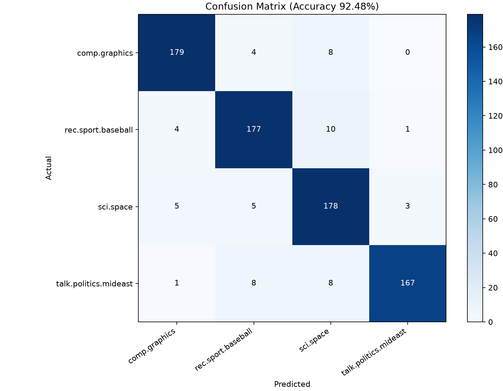

# A4_1 평가 대비 질의응답

2026-11-12 기준입니다. [미션 PDF](A4_1_mission.pdf) 2쪽의 학습목표 순서로 Q1~Q5를 구성하고, [평가 PDF](A4_1_eval.pdf) 10~11쪽의 항목 1~5와 연결했습니다. 첨부된 Python 코드를 복원하고 실행 결함을 수정했습니다. 아래 수식과 작은 예제는 동작 설명에 사용하며, 전체 데이터 실측은 생성된 검증 산출물을 근거로 기록합니다.

## 평가표 번호별 대응

| 평가표 번호 | PDF의 질문 순서 | 답변 및 제출 근거 |
| --- | --- | --- |
| 항목 1-1 | TF-IDF 허용 오차와 sklearn 설정 | Q2, README 1·2단, `verify_tfidf.py` |
| 항목 1-2 | NumPy 코사인 구현과 관련 문서 검색 | Q3, `src/search_engine.py`, README 검색 CLI |
| 항목 1-3 | Accuracy·F1·혼동 행렬 | README 2단, `src/classifier.py` |
| 항목 1-4 | 전처리 동작과 설계 근거 | Q1·Q5, `src/preprocess.py`, `resources/stopwords_en.txt` |
| 항목 1-5 | 실제 오분류 5건 이상 | Q4, README 3단, 분류기의 Test 오분류 추출 |
| 항목 1-6 | 실행 방법 명시 및 실제 실행 | README 실행 블록, `main.search` 함수, `--build-index` 저장·재로딩 |
| 항목 2-1 | 전처리·벡터화·검색·분류 분리 이유 | Q5 후속 답변 |
| 항목 2-2 | TF → IDF → TF-IDF 구현 단계 | Q2 |
| 항목 2-3 | 다른 데이터셋에 적용하는 설계 | Q5 후속 답변 |
| 항목 3-1 | TF·IDF·TF-IDF 정의와 로그 사용 이유 | Q2 |
| 항목 3-2 | 정규화의 필요성과 코사인 선택 이유 | Q3 |
| 항목 3-3 | 행렬 shape의 의미 | Q2 |
| 항목 4-1 | BoW의 한계와 구체적 사례 | Q4 |
| 항목 4-2 | 사과의 여러 의미가 섞이는 검색 | Q4 후속 답변 |
| 항목 4-3 | 백만 문서 실시간 검색의 병목 | Q3 후속 답변 |
| 항목 4-4 | 재구현 개선점과 검색 품질 정량 평가 | Q4 후속 답변 |
| 항목 5 | 보너스 해결에 따른 크레딧 | README 하단 보너스 섹션, `src/bonus/` |

평가 PDF 2쪽 소개에는 정규식 정보 추출·감성 분석도 언급됩니다. 상세 미션과 실제 평가문항은 TF-IDF 검색·분류를 중심으로 제시돼 있어 본 문서는 해당 상세 요구사항에 맞췄습니다.

## Q1. 토큰화의 목적과 언어별 처리 방식은 무엇인가

### 핵심 답변 3줄 요약

1. 토큰화는 텍스트를 집계 가능한 단위로 나눠 어휘 사전과 TF 행렬을 만드는 과정입니다.
2. 영어는 공백과 구두점을 기준으로 시작할 수 있고, 한국어는 조사와 어미를 고려한 형태소 분석이 단어 변형을 묶는 데 도움이 됩니다.
3. 이 프로젝트는 소문자화 후 Unicode 단어 문자 두 개 이상의 토큰을 추출하며 sklearn 검증에도 같은 함수를 전달합니다.

### 수식과 코드 근거

문서 $d$를 토큰열 $T(d)$로 바꾸면 $tf(d,t)=\sum_{u\in T(d)}\mathbf{1}[u=t]$입니다. 실제 전처리 클래스로 토큰 규칙을 확인할 수 있습니다.

```python
from src.preprocess import TextPreprocessor

tokens = TextPreprocessor(stopwords=set()).tokenize("Space, SATELLITE! a 3D_x")
assert tokens == ["space", "satellite", "3d_x"]
```

이 예제에서는 한 글자 `a`가 제거되고 `3d_x`는 남습니다. 한국어의 `학교`, `학교에`, `학교에서`는 공백 토큰화 시 서로 다른 토큰이 될 수 있습니다. 형태소 분석으로 `학교`를 공통 단위로 묶을 때 어휘 크기와 OOV 비율이 달라집니다. 한국어에 적용할 경우 분석기·버전을 고정하고 같은 분할에서 성능을 비교해야 합니다.

`TextPreprocessor.tokenize`가 소문자화·정규식 추출·불용어 제거를 수행합니다. 불용어 경로는 모듈 위치를 기준으로 정해 실행 디렉터리가 바뀌어도 같은 목록을 읽습니다. [전처리 구현](../src/preprocess.py), [고정 불용어 목록](../resources/stopwords_en.txt)

## Q2. TF, IDF, TF-IDF의 정의와 역할은 무엇인가

### 핵심 답변 3줄 요약

1. TF는 문서 안의 단어 빈도이며 IDF는 여러 문서에서 흔한 단어의 가중치를 낮춥니다.
2. Smooth IDF는 $\ln((1+N)/(1+df))+1$이며 TF와 곱한 후 문서별 L2 정규화를 적용합니다.
3. Train에서 학습한 어휘·IDF를 Test와 쿼리에 적용하고, 동일 설정의 sklearn 결과와 `1e-6` 이내 오차인지 비교합니다.

### 수식과 코드 근거

$$tf(d,t)=c_{d,t},\quad df(t)=\sum_d\mathbf{1}[c_{d,t}>0]$$
$$idf(t)=\ln\left(\frac{1+N}{1+df(t)}\right)+1,\quad X_{d,t}=tf(d,t)idf(t)$$

로그는 문서 빈도 역수의 차이를 완만하게 만들어 드문 단어의 가중치가 지나치게 커지는 것을 줄입니다. Smoothing은 분모를 안정화하며 `+1`은 모든 Train 문서에 있는 단어의 IDF를 1로 유지합니다. 다음은 두 문서와 두 단어의 설명용 계산입니다.

```python
import numpy as np

counts = np.array([[2, 1], [0, 1]], dtype=np.float64)
df = np.count_nonzero(counts, axis=0)
idf = np.log((1 + len(counts)) / (1 + df)) + 1
weighted = counts * idf
norms = np.linalg.norm(weighted, axis=1, keepdims=True)
normalized = np.divide(
    weighted, norms, out=np.zeros_like(weighted), where=norms != 0
)
assert np.allclose(idf, [1.4054651081081644, 1.0])
assert normalized.shape == (2, 2)
```

첫 단어는 한 문서에만 있어 IDF가 약 1.405465이고, 두 번째 단어는 두 문서에 모두 있어 1입니다. 행렬의 각 행은 문서, 각 열은 학습 어휘의 단어이므로 shape는 `(N, |V|)`입니다. Test 문서 수가 $M$이면 변환 결과는 `(M, |V|)`가 됩니다.

실제 참조 설정은 `smooth_idf=True`, `sublinear_tf=False`, `norm='l2'`, `dtype=np.float64`와 공통 callable analyzer `TextPreprocessor.tokenize`입니다. 검증 스크립트는 어휘 열 순서·TF·DF·IDF와 Train/Test/쿼리 벡터를 비교하고 허용 오차 `1e-6`을 초과하면 실패합니다. [NumPy 벡터라이저](../src/tfidf.py), [단계별 검증](../verify_tfidf.py)

로컬 실측에서 어휘 크기는 33,297이며 Train shape는 `(3029, 33297)`, Test shape는 `(758, 33297)`입니다. Train 최대 오차는 `2.3315e-15`, Test 최대 오차는 `8.3267e-16`, 검증 쿼리 다섯 건의 최대 오차와 IDF 오차는 0입니다. 모두 미션의 `1e-6` 기준을 통과했습니다. [실측 검증 결과](../artifacts/tfidf_verification.json)

## Q3. 코사인 유사도는 내적과 정규화로 어떻게 계산하는가

### 핵심 답변 3줄 요약

1. 코사인은 두 벡터의 내적을 각 벡터의 L2 길이 곱으로 나눠 방향의 유사도를 계산합니다.
2. L2 정규화된 문서와 쿼리는 `D @ q`로 점수를 계산하며, 0벡터는 별도 처리합니다.
3. 문서 길이에 따른 크기 차이를 줄이고 상위 5개를 반환하되, 관련도 정답으로 실제 검색 품질도 확인해야 합니다.

### 수식과 코드 근거

$$\cos(x,q)=\frac{\sum_t x_tq_t}{\sqrt{\sum_t x_t^2}\sqrt{\sum_t q_t^2}}=\hat{x}\cdot\hat{q}$$

```python
import numpy as np

x = np.array([3.0, 4.0])
q = np.array([0.0, 2.0])
score = (x @ q) / (np.linalg.norm(x) * np.linalg.norm(q))
assert np.isclose(score, 0.8)
assert np.isclose((x / np.linalg.norm(x)) @ (q / np.linalg.norm(q)), 0.8)
```

내적 8을 길이 곱 10으로 나눠 유사도 0.8이 됩니다. 원시 유클리드 거리는 문서 길이에 따라 달라집니다. 단위 벡터에서는 $\|\hat{x}-\hat{q}\|^2=2-2\cos(x,q)$이므로 두 기준이 같은 순위를 줄 수 있습니다. OOV만 있는 쿼리는 정규화 분모가 0이므로 영벡터를 유지하고 빈 결과를 반환합니다. 검색 결과는 양수 점수만 포함하고 점수 내림차순·동점 문서 ID 오름차순으로 정렬합니다. [검색과 순위 구현](../src/search_engine.py)

### 백만 문서로 확장한다면

Dense `float64` TF-IDF 행렬은 $8N|V|$ 바이트가 필요합니다. $N=10^6$, $|V|=50,000$이면 원소 저장에만 400GB, 약 372.5GiB가 필요하고 질의당 전체 스캔은 $O(N|V|)$입니다. 희소 행렬과 역색인으로 쿼리 단어의 posting만 순회하고 후보 Top-K를 계산하는 방식으로 확장할 수 있습니다. 인덱스 업데이트, 캐시와 동시 질의 처리도 함께 설계해야 합니다. 구축 시간·메모리·질의 지연 p50/p95를 측정하고 동일 쿼리에서 품질과 점수 동치성을 확인해야 합니다.

## Q4. BoW가 문맥과 어순을 잃는 한계는 무엇인가

### 핵심 답변 3줄 요약

1. Unigram BoW는 단어 빈도를 집계하므로 동일 단어를 다른 순서로 배치해도 같은 벡터가 됩니다.
2. 다의어는 하나의 열로 합쳐지고 동의어는 다른 열로 나뉘어 의미와 벡터 유사도가 어긋날 수 있습니다.
3. 실제 오분류 문서 5건에서 원문·레이블·기여 단어를 대조한 뒤 bigram과 문맥 모델의 개선 효과를 측정해야 합니다.

### 수식과 코드 근거

```python
from collections import Counter

a = Counter("dog bites man".split())
b = Counter("man bites dog".split())
assert a == b
```

같은 어휘 빈도에 같은 IDF를 곱하므로 TF-IDF도 같습니다. 반면 주어와 목적어가 바뀌어 의미는 달라집니다. `not good`에서 `not`을 불용어로 제거하면 `good`만 남아 부정이 사라질 수 있습니다. 이 예제는 한계를 설명하기 위한 구성 사례입니다.

분류기는 `LogisticRegression(max_iter=1000, random_state=42)`로 학습하고 Test의 Accuracy·Macro-F1·혼동 행렬과 실제 오분류 다섯 건을 저장합니다. 오분류에는 Test 문서 ID, 실제·예측 레이블과 본문을 기록하며, 원인 분석에서는 해당 본문의 어휘와 문맥을 연결해야 합니다. 저장된 본문의 이름과 연락처는 별도 검수가 필요합니다. [분류 및 오분류 추출 구현](../src/classifier.py)

로컬 실측은 Test 758건 중 701건 정답으로 Accuracy `92.4802%`, Macro-F1 `0.925329`입니다. 아래 사례는 실제 Test 오분류를 바탕으로 해석한 원인 가설입니다. 게시물의 실제 범주와 본문의 주제가 어긋나거나 앞선 대화에 의존할 수 있으므로 개선 효과는 재실험으로 확인해야 합니다. [분류 지표와 추출 사례](../artifacts/classifier_metrics.json)

선형 모델에서 예측 클래스와 실제 클래스의 점수 차이는 다음과 같이 분해됩니다. 양수 단어 기여는 예측 클래스를, 음수 기여는 실제 클래스를 지지합니다. 기여도는 모델의 선형 점수 단위입니다.

$$\Delta=(b_{\hat y}-b_y)+\sum_t x_t(w_{\hat y,t}-w_{y,t})$$

| Test ID | 실제 → 예측 | 실측 기여와 BoW 원인 해석 |
| --- | --- | --- |
| 3 | talk.politics.mideast → sci.space | `palestinian police force` 제안을 묻는 짧은 글입니다. `palestinian` −0.3580에도 `idea` +0.2409, `stage` +0.0914, `fit` +0.0788과 절편 차이 +0.2461이 작용해 최종 차이가 +0.0123입니다. 범용 단어의 합이 정치 문맥을 충분히 표현하지 못한 사례입니다. |
| 5 | comp.graphics → sci.space | `9 x 6`, `base 13`을 언급하는 짧은 참조입니다. `system` +0.1815, `base` +0.0935가 예측을 지지하며 최종 차이는 +0.4278입니다. 직접적인 그래픽 어휘와 대화·문화적 문맥이 부족합니다. |
| 13 | comp.graphics → rec.sport.baseball | compiler·COBOL·Pascal 관련 농담입니다. `compiler` −0.0895보다 이름 토큰 +0.2122, `think` +0.1741 등 공유 표현의 영향이 커 최종 차이가 +0.2199입니다. 남은 서명과 일반 표현의 우연한 연관이 오판에 기여했습니다. 문서에는 이름 토큰을 가려 기재했습니다. |
| 19 | rec.sport.baseball → sci.space | 과거 잡지 기사 날짜를 묻습니다. `si` +0.1221, `date` +0.0700과 절편 차이 +0.0771 등이 작용해 최종 차이는 +0.0233입니다. 짧은 약어와 이전 대화 맥락을 빈도만으로 해석하기 어렵습니다. |
| 25 | talk.politics.mideast → sci.space | 짧은 반문에서 전처리 후 한 토큰만 남습니다. 해당 토큰 기여 −0.1325보다 절편 차이 +0.2461이 커 최종 차이는 +0.1136입니다. 주제 어휘의 희소성 때문에 절편의 영향이 상대적으로 커졌습니다. |



### 사과 검색에서 과일·기업·용서 문서가 섞인다면

같은 표면형 `사과`가 하나의 차원에 매핑돼 의도를 구분하기 어렵습니다. 주변 단어를 반영하는 n-gram, 질의 확장 또는 명확화, 문맥 임베딩을 비교할 수 있습니다. 단일 단어 쿼리의 의도가 불명확한 경우에는 사용자에게 의미 선택을 제공하는 방식도 가능합니다.

### 재구현과 검색 품질 평가

관련도 정답이 있는 평가 쿼리 집합을 만들고 `Precision@5 = Top-5 중 관련 문서 수 / 5`와 순위별 관련도를 반영한 nDCG@5를 측정합니다. 예를 들어 결과 다섯 건 중 네 건이 관련 문서이면 Precision@5는 0.8입니다. 같은 학습·평가 분할을 유지하면서 unigram, bigram, BM25, 문맥 모델을 비교하고 개선 선택에는 질의 지연도 함께 고려합니다. 분류 성능은 Accuracy와 Macro-F1, 클래스별 혼동 행렬로 별도 측정합니다.

## Q5. 전처리 기준은 어떤 근거로 설계했는가

### 핵심 답변 3줄 요약

1. 소문자화와 두 글자 이상 단어 정규식으로 표기 변동과 일부 잡음을 줄이며 참조 구현과 같은 토큰열을 사용합니다.
2. 불용어 목록은 고정 파일로 관리하고 부정어·도메인 핵심어의 정보 손실을 검토합니다.
3. Train 전용 어휘·IDF 학습과 공통 전처리 함수로 데이터 누수를 차단하고 변경 효과를 재현 가능하게 비교합니다.

### 수식과 코드 근거

```python
import re

# 규칙을 설명하기 위한 작은 불용어 집합입니다.
stopwords = {"the", "and"}
text = "The SPACE and satellite."
tokens = [t for t in re.findall(r"(?u)\b\w\w+\b", text.lower())
          if t not in stopwords]
assert tokens == ["space", "satellite"]
```

이 규칙에서 한 글자 `R`과 `C++`는 사라질 수 있으며, 숫자와 밑줄은 단어 문자로 취급됩니다. 따라서 실제 데이터의 도메인 용어를 확인하고 정규식 변경 전후 어휘 크기, OOV 비율, Macro-F1과 검색 품질을 비교해야 합니다. 현재 불용어 파일에는 `no`, `nor`, `not`도 포함돼 부정 의미를 잃을 수 있습니다. 첨부 코드의 목록을 고정해 사용하며 목록의 원출처와 버전은 확인이 필요합니다. 동의어 치환은 적용하지 않습니다. [불용어 목록](../resources/stopwords_en.txt)

### 모듈을 분리하는 이유와 새 데이터셋 적용

전처리는 토큰열 생성, 벡터화는 어휘·IDF 학습과 변환, 검색은 점수와 순위 계산, 분류는 모델 학습과 평가를 담당하도록 나눕니다. 같은 전처리와 벡터 표현을 검색과 분류에서 재사용하고 단계별 오류를 확인할 수 있기 때문입니다.

새 데이터셋에서는 `load_data`의 `(문서, 레이블)` 반환 규격과 tokenizer를 교체해 벡터화·검색 코드를 재사용할 수 있습니다. 현재 카테고리는 `CATEGORIES`, 캐시 경로는 프로젝트의 `artifacts/data_cache`로 지정돼 있습니다. 데이터 로더는 헤더·푸터·인용문 제거, 이메일·일반 전화번호 형식 마스킹, 빈 본문 제외 후 층화 8:2 분할을 수행합니다. `random_state=42`, 클래스별 건수와 코퍼스 해시를 메타데이터에 저장합니다. [데이터 로더](../src/dataset.py)

실측 데이터는 원본 3,894건에서 빈 본문 107건을 제외한 3,787건이며 Train 3,029건, Test 758건입니다. 카테고리 순서별 Test 건수는 `[191, 192, 191, 184]`입니다. [데이터 메타데이터](../artifacts/dataset_metadata.json)

미션의 개인정보 미포함 조건은 이름·본문 수동 검수가 남아 있습니다. 공개 데이터셋의 이용·재배포 조건과 불용어 목록의 원출처도 확인해야 합니다. 자동 마스킹의 적용 범위를 발표에서 함께 설명합니다.

## 보너스 구술 대비

Double Normalization은 양수 빈도에만 $0.5+0.5tf/\max(tf)$를 적용하고 0은 0으로 보존해야 합니다. 빈 문서에서 최댓값이 0이 되는 경우도 처리합니다. Raw·Log·Double을 같은 분할로 비교하며 분류와 검색의 정량 지표를 각각 제시해야 합니다.

| TF 방식 | Accuracy | Macro-F1 | 우주 쿼리의 Raw Top-5와 겹침 비율 |
| --- | --- | --- | --- |
| Raw Count | 92.4802% | 0.925329 | 1.0 |
| Log Normalization | 92.4802% | 0.925139 | 0.6 |
| Double Normalization | 91.9525% | 0.919962 | 0.4 |

검색 순위의 겹침 비율은 TF 변화에 따른 결과 구성을 보여 줍니다. 검색 품질을 판정하려면 관련도 정답과 Precision@5·nDCG@5 평가가 추가로 필요합니다. [보너스 실측 결과](../artifacts/bonus_metrics.json)

BM25는 TF 포화와 문서 길이 보정을 사용합니다. $k_1=1.5$, $b=0.75$로 Toy 문서 세 건을 독립 수식 계산과 비교했습니다. 기대 점수는 `[1.5908508973, 0.4700036292, 0]`이며 최대 오차는 `2.2204e-16`입니다. 같은 네 쿼리에서 TF-IDF와 BM25 Top-5도 기록했습니다. [보너스 실측 결과](../artifacts/bonus_metrics.json)

역색인은 단어별 posting으로 후보를 줄입니다. 빈 입력·OOV·반복 단어를 포함한 일곱 쿼리에서 최대 점수 오차 0, Top-5 순위 일치율 100%를 확인했습니다. 구축 시간은 0.483355초였습니다. 우주 쿼리의 점수 계산·Top-5 선택 시간은 dense 29.2290ms, 역색인 0.3928ms였습니다. 이 시간은 벡터화 시간을 제외하고 BLAS 2스레드, 세 번 실행의 중앙값으로 측정했으며 하드웨어와 쿼리에 따라 달라집니다. [보너스 실측 결과](../artifacts/bonus_metrics.json)
