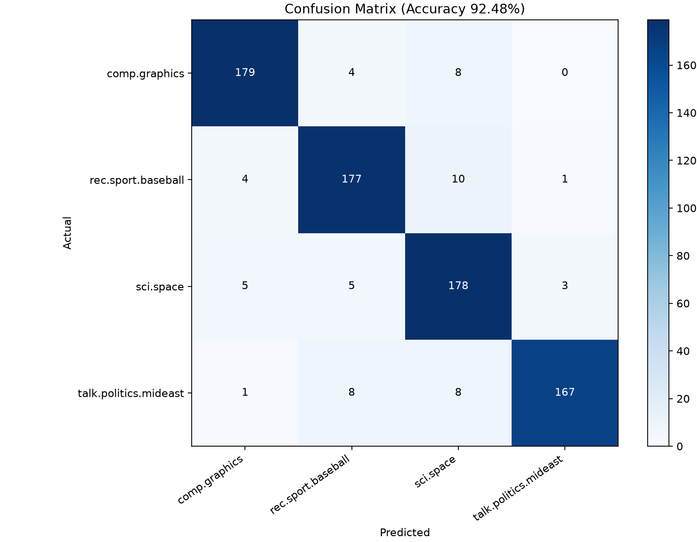

# A4_1 발표 개요

구술 평가용 Markdown 발표 개요입니다. 기본 설명 8분과 질의응답 2분을 가정했습니다. 슬라이드 구분은 `---`로 표시했습니다. 2026-11-12 첨부 코드를 복원하고 로컬에서 측정한 결과를 반영했습니다.

## 프로젝트 개요

- 목표는 20 Newsgroups 문서의 TF-IDF를 NumPy로 계산해 검색과 분류에 활용하는 것입니다.
- 대상은 `comp.graphics`, `rec.sport.baseball`, `sci.space`, `talk.politics.mideast` 네 카테고리입니다.
- 원본 3,894건에서 빈 본문 107건을 제외한 3,787건을 사용했습니다.
- 층화 8:2 분할과 `random_state=42`로 Train 3,029건, Test 758건을 고정했습니다.

발표 메모는 “빈도 벡터로 검색과 분류를 수행하고 문맥·어순 손실이 만드는 한계를 실제 오류와 연결한다”입니다. 원본 건수와 클래스별 분포는 [데이터 메타데이터](../artifacts/dataset_metadata.json)를 근거로 설명합니다.

---

## 핵심 아키텍처

```text
문서 로딩 → 이메일·전화번호 마스킹 → 빈 본문 제외 → 층화 Train/Test 분할
                                                       ↓
                                    Train 전용 어휘·IDF 학습
                                                       ↓
                                         문서·쿼리 TF-IDF 변환
                                           ↙              ↘
                              NumPy 코사인 검색        Logistic Regression
                                 Top-5 반환              Test 평가
                                 인덱스 저장          혼동 행렬·오분류 추출
```

`src/preprocess.py`는 토큰화와 불용어 제거, `src/tfidf.py`는 어휘·IDF 학습과 변환, `src/search_engine.py`는 점수와 순위, `src/classifier.py`는 학습·평가를 담당합니다. 같은 표현을 검색과 분류에 재사용하고 단계별 오류를 확인하기 위해 분리했습니다.

발표에서는 어휘와 IDF를 Train에서만 학습한다는 점을 설명합니다. 헤더·푸터·인용문 제거와 이메일·일반 전화번호 마스킹을 적용했습니다. 이름과 본문의 수동 개인정보 검수 및 데이터 이용 조건 확인은 남아 있습니다.

---

## TF-IDF 계산과 참조 검증

$$tf(d,t)=c_{d,t},\qquad idf(t)=\ln\left(\frac{1+N}{1+df(t)}\right)+1$$
$$x_{d,t}=tf(d,t)idf(t),\qquad\hat{x}_d=x_d/\|x_d\|_2$$

- 공통 analyzer `TextPreprocessor.tokenize`, 알파벳 순 어휘, `float64`를 사용합니다.
- sklearn 설정은 `smooth_idf=True`, `sublinear_tf=False`, `norm='l2'`입니다.
- 검증은 어휘·열 순서 → TF·DF·IDF → Train/Test/쿼리 벡터 순서로 수행합니다.
- 빈 문서, 불용어만 있는 문서, OOV 쿼리는 0벡터를 유지하는지 검사합니다.

두 문서의 빈도 행렬 `[[2, 1], [0, 1]]`에서 IDF `[1.405465, 1]`이 나오는 작은 예제로 희귀 단어의 상대 가중치를 설명합니다. 실제 학습 어휘는 33,297개이며 Train 행렬의 shape는 `(3029, 33297)`입니다.

---

## 1e-15 수준 오차 달성의 증거

| 비교 대상 | 최대 절대 오차 | 평균 절대 오차 |
| --- | --- | --- |
| Train 3,029건 | 2.3315e-15 | 3.0568e-20 |
| Test 758건 | 8.3267e-16 | 2.2134e-20 |
| 검증 쿼리 5건 | 0 | 0 |

IDF 오차는 0이며 어휘·TF·DF·IDF와 최종 벡터 검사를 통과했습니다. 미션 허용 오차는 `1e-6` 이내입니다. `1e-15 수준`은 측정값의 규모를 뜻하며 판정 기준과 함께 제시합니다. [실측 검증 결과](../artifacts/tfidf_verification.json)

---

## 검색과 분류 성능

- 검색은 L2 정규화 문서 행렬과 쿼리의 `D @ q`로 계산합니다.
- 시연 쿼리는 `space satellite launch orbit`, 반환 수는 5입니다.
- 결과는 점수·문서 ID·150자 스니펫을 포함하고 점수 동점은 문서 ID로 정렬합니다.
- `--build-index`로 저장한 인덱스를 함수 호출과 CLI에서 재사용합니다.
- 분류는 `LogisticRegression(max_iter=1000, random_state=42)`로 학습했습니다.

| 분류 지표 | 로컬 실측 |
| --- | --- |
| Accuracy | 92.4802% (701 / 758) |
| Macro-F1 | 0.925329 |
| 모델 학습 반복 | 27회 |

혼동 행렬의 세로축은 실제 클래스, 가로축은 예측 클래스입니다. `sci.space`로 잘못 예측한 사례는 나머지 세 클래스에서 합계 26건입니다. [분류 지표](../artifacts/classifier_metrics.json)



---

## BoW 한계와 실제 오분류

| Test ID | 실제 → 예측 | 본문에서 확인한 특징과 원인 가설 |
| --- | --- | --- |
| 3 | 중동 정치 → 우주 | `palestinian` −0.3580에도 `idea` +0.2409와 절편 차이 +0.2461 등이 작용해 점수 차이 +0.0123 |
| 5 | 그래픽 → 우주 | `system` +0.1815, `base` +0.0935가 짧은 수학·문화 참조의 예측에 기여해 점수 차이 +0.4278 |
| 13 | 그래픽 → 야구 | 이름 토큰 +0.2122, `think` +0.1741이 오판에 기여해 점수 차이 +0.2199. 이름은 발표에서 가림 |
| 19 | 야구 → 우주 | `si` +0.1221, `date` +0.0700 등 약어·일반 어휘와 절편이 작용해 점수 차이 +0.0233 |
| 25 | 중동 정치 → 우주 | 한 토큰의 기여 −0.1325보다 절편 차이 +0.2461이 커 점수 차이 +0.1136 |

점수 차이는 예측 클래스와 실제 클래스의 선형 점수 차이이며 양수 단어 기여는 예측 클래스를 지지합니다. 실제 오류와 모델 기여도를 관찰한 뒤 해석한 원인 가설입니다. unigram BoW는 게시물의 대화 맥락과 상식적 참조를 담기 어렵습니다. 현재 불용어 목록의 `no`, `nor`, `not` 제거도 부정 의미를 잃을 수 있습니다. bigram·문맥 모델의 개선 효과는 같은 분할에서 재실험해야 합니다.

---

## 질의응답 대비

1. 토큰화가 빈도 행렬 생성에 필요한 이유와 한국어·영어의 처리 차이
2. TF·IDF의 역할, 로그와 smoothing의 이유, `(N, |V|)` shape의 의미
3. 내적을 벡터 길이로 나누는 이유와 영벡터 처리
4. 사과의 여러 의미가 섞이는 원인과 bigram·문맥 모델 비교
5. 불용어·특수문자 처리 근거와 Train 전용 학습

백만 문서와 어휘 5만 개의 dense float64 표현은 원소만 약 400GB입니다. 희소 저장·역색인과 질의 지연 측정 방안을 설명합니다. 검색 품질은 관련도 정답을 이용한 Precision@5와 nDCG@5로 비교합니다. 상세 답변과 PDF 평가항목 번호별 대응은 [Q&A](A4_1_mission_QnA.md)에 있습니다.

---

## 보너스 발표 부록

| 과제 | 설명할 내용 | 로컬 실측 |
| --- | --- | --- |
| TF 변형 | Raw·Log·Double, 0 빈도 유지, 동일 분할 | Accuracy 92.4802% / 92.4802% / 91.9525% |
| BM25 | TF 포화·길이 보정, k1=1.5, b=0.75 | 독립 수식 Toy 최대 오차 2.2204e-16 |
| 역색인 | posting 기반 후보 추출, 구축·검색 시간 분리 | 일곱 쿼리 점수 오차 0, Top-5 순위 100% 일치 |

Log와 Double의 Macro-F1은 각각 0.925139와 0.919962입니다. 우주 쿼리의 Raw Top-5와 겹침 비율은 Log 0.6, Double 0.4로 순위 구성이 달라졌습니다. 검색 관련도 정답을 추가해 품질 차이를 평가해야 합니다.

역색인 구축은 0.483355초였습니다. 우주 쿼리에서 dense 29.2290ms, 역색인 0.3928ms가 측정됐습니다. 점수 계산과 Top-5 선택을 포함하고 벡터화 시간을 제외했으며 BLAS 2스레드, 세 번 실행 중앙값입니다. 하드웨어와 쿼리에 따라 시간은 달라집니다. [보너스 실측 결과](../artifacts/bonus_metrics.json)

---

## 시연 명령과 재현 환경

검증 환경은 Windows, Python 3.14.7, uv 0.13.7입니다. NumPy 2.5.4, scikit-learn 1.9.1, matplotlib 3.11.2, seaborn 0.13.2를 사용합니다. 프로젝트의 고정 불용어 파일과 `random_state=42`를 유지합니다.

요청된 검증·검색·분류·보너스 명령은 모두 종료 코드 0으로 실행됐습니다. [실행 결과 목록](../artifacts/verification_results.json)

```bash
python verify_tfidf.py
python main.py --build-index
python main.py --query "space satellite launch orbit" --topk 5
python main.py --train-classifier
python main.py --bonus
```

인덱스를 생성한 후 파이썬에서 아래 함수 호출도 시연할 수 있습니다.

```python
from main import search

for score, doc_id, snippet in search("space satellite launch orbit", top_k=5):
    print(f"{score:.4f} {doc_id} {snippet}")
```
